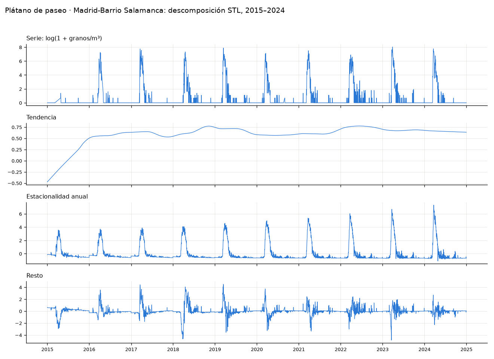
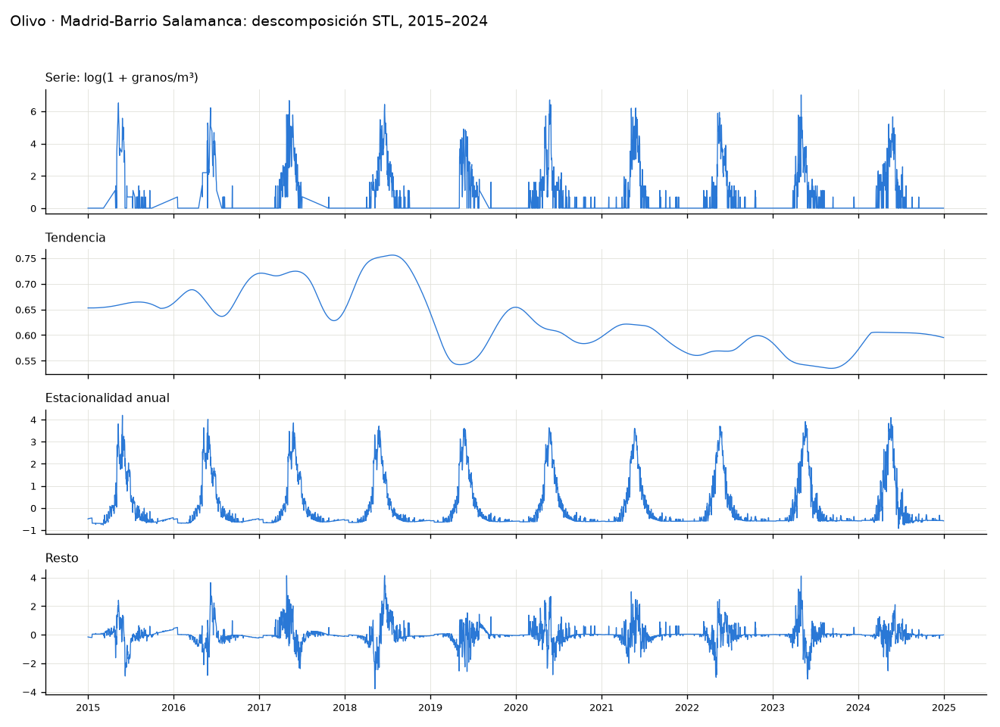
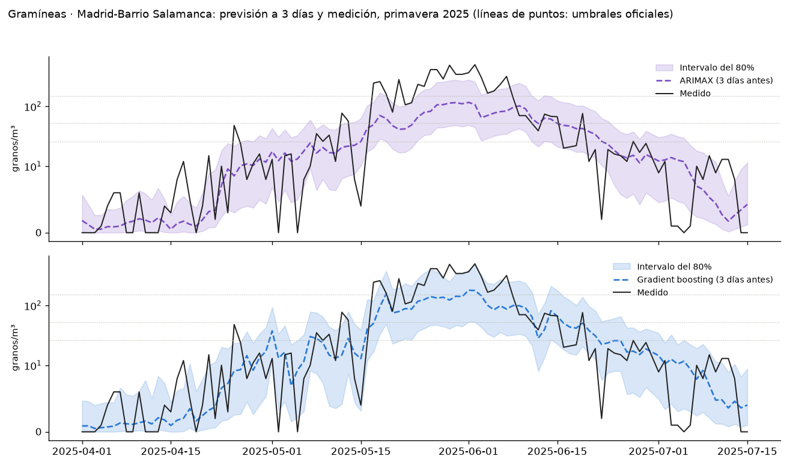

# Informe de modelos: cómo predecimos el polen

*Respira MAD · DataMad 2026. Hecho por `compare_models.py` (números y gráficos) el 16 de noviembre de 2026.*

Este informe compara cuatro formas de predecir el polen de los próximos cinco
días y explica cuál usa la aplicación para cada tipo de polen y por qué.

## 1. Qué se predice y con qué reglas

- **La serie.** Para cada estación de la Red Palinocam y cada tipo de polen
  hay una serie diaria de granos por metro cúbico desde 1993. Todos los modelos
  trabajan con `log(1 + granos/m³)`: el logaritmo "aplasta" los picos enormes y
  el `1 +` permite que haya días con cero.
- **El retraso.** Las lecturas se publican unos 3 días tarde. Una previsión
  hecha el día D solo conoce lecturas hasta D−3. Por eso "mañana" (día +1) está
  en realidad a 4 días de la última lectura, y el día +5 a 8 días.
- **Entrenamiento y prueba.** Los modelos se ajustan con datos hasta 2024 y se
  prueban con 2025, un año que ninguno ha visto. Durante 2025 no se reajusta
  nada: solo se les van dando las lecturas nuevas con su retraso.
- **Meteorología honesta.** Para los días que se predicen, los modelos que usan
  el tiempo reciben la *previsión* meteorológica tal como se emitió entonces
  (archivo de Open-Meteo), no el tiempo que hizo después.
- **Mismas condiciones para todos.** Los cuatro modelos se evalúan sobre
  exactamente las mismas 198.600 filas (estación, tipo, día, antelación), con
  las mismas métricas:
  - **MAE en escala logarítmica**: el error medio, en valor absoluto, entre
    `log(1 + previsto)` y `log(1 + real)`. Cuanto más bajo, mejor. Un MAE de
    0,7 significa equivocarse, de media, en un factor de 2 aproximadamente.
  - **Acierto del nivel oficial**: porcentaje de días en que la previsión cae
    en el mismo nivel oficial (bajo, medio, alto, muy alto) que la medición.
  - Solo se cuentan los **días de temporada** de cada tipo de polen. Fuera de
    temporada todo es "bajo" y cualquier método acierta casi el 100 %.

## 2. Por qué el polen es una serie difícil

1. **Ciclo anual muy marcado.** Cada tipo aparece unas semanas al año y el
   resto del tiempo está a cero. La fuerza estacional (STL) es alta, pero la
   temporada no empieza el mismo día cada año: depende del calor acumulado.
2. **Muchos ceros.** Entre el 46 % y el 78 % de los días de las series de
   ejemplo son cero. Los modelos clásicos suponen errores "en campana"
   (normales) y eso no se cumple cuando la serie se pega al cero.
3. **Picos.** En temporada la concentración puede multiplicarse por diez de un
   día a otro (viento, un día seco tras la lluvia) y volver a bajar.
4. **El tiempo manda.** La lluvia limpia el aire, el calor adelanta la
   floración, el viento trae polen de fuera.
5. **Retraso y huecos.** Se predice a ciegas 4–8 días después de la última
   lectura, y hay días (y a veces meses) sin lectura en algunas estaciones.

### Diagnóstico de tres series de ejemplo (Madrid-Barrio de Salamanca, 2015–2024)

| Serie | ADF (serie) | p | ADF (sin ciclo anual) | p | Días con cero | Fuerza estacional (STL) |
|---|---|---|---|---|---|---|
| Gramíneas · Madrid-Barrio Salamanca | -5.9 | 0.0000 | -9.4 | 0.0000 | 46% | 0.77 |
| Plátano de paseo · Madrid-Barrio Salamanca | -9.3 | 0.0000 | -12.6 | 0.0000 | 78% | 0.77 |
| Olivo · Madrid-Barrio Salamanca | -7.8 | 0.0000 | -10.0 | 0.0000 | 70% | 0.73 |

- **Prueba ADF (Dickey-Fuller aumentada).** Pregunta si la serie "deambula" sin
  volver a su nivel (raíz unitaria). Un valor p menor que 0,05 lo descarta. En
  las tres series p < 0,0001, con y sin el ciclo anual: **no hace falta
  diferenciar la serie (d = 0)**. La estacionalidad se trata aparte, con
  términos de Fourier.
- **ACF y PACF.** La ACF de la serie original baja muy despacio: es el ciclo
  anual. Al quitar el ciclo anual y la meteorología, la ACF decae poco a poco y
  la PACF tiene 2–3 retardos claros: es el patrón de un modelo AR de orden bajo
  con algo de media móvil, es decir, un ARMA(1–2, 1–2).
- **STL.** Separa la serie en tendencia (casi plana), estacionalidad anual (la
  "joroba" de cada primavera) y resto (los picos y valles que quedan, de tamaño
  parecido a la propia estacionalidad: ahí está la dificultad).

| Serie | ACF / PACF | Descomposición STL |
|---|---|---|
| Gramíneas |  |  |
| Plátano de paseo |  |  |
| Olivo |  |  |

## 3. Los cuatro modelos

### a) Estacional ingenuo (referencia)
"Habrá lo mismo que el mismo día del año pasado." No aprende nada: sirve de
listón mínimo. Si un modelo no lo supera, no merece la pena.

### b) Suavizado exponencial (ETS / Holt)
Mantiene un "nivel" que se actualiza con cada lectura nueva: una parte α de la
lectura y el resto del nivel anterior. Holt añade una tendencia, y Holt
amortiguado hace que esa tendencia se vaya apagando. Se probaron las tres
variantes en cada serie y se eligió la de menor AIC: en 99 de 100 series ganó
el **suavizado simple** (sin tendencia), con α ≈ 0,5. Su previsión es una línea
plana a partir del último nivel: no sabe nada del calendario ni del tiempo.

### c) ARIMAX (regresión armónica dinámica)
Es una regresión con errores ARMA:

`log(1 + granos) = ciclo anual + meteorología del día + error ARMA`

- **Ciclo anual**: pares de senos y cosenos (términos de Fourier) de periodo
  365,25 días. El número de pares (de 1 a 8) se elige con el AIC; salen 6–8
  porque la temporada es una joroba estrecha y hacen falta muchas ondas para
  dibujarla.
- **Variables exógenas**: temperatura media, lluvia (en logaritmo), viento
  máximo y humedad del propio día. Ejemplo (gramíneas, Barrio de Salamanca):
  cada grado más sube el polen un 6–7 %, y la lluvia lo baja.
- **Error ARMA(p, 0, q)**: lo que añaden las últimas lecturas. d = 0 por la
  prueba ADF; p y q se eligen por AIC entre siete candidatos sugeridos por la
  ACF/PACF. En casi todos los tipos gana ARMA(2, 0, 1).
- Se ajusta un modelo por estación y tipo con 2015–2024 (statsmodels,
  `SARIMAX`). Da intervalos de predicción de forma nativa.

### d) Gradient boosting (el modelo que ya tenía la aplicación)
Muchos árboles de decisión pequeños que se corrigen unos a otros
(scikit-learn). Un modelo por tipo de polen y día de antelación, entrenado con
**todas las estaciones juntas y con toda la historia (1993–2024)**. Usa 27
variables: día del año, últimas lecturas y su antigüedad, medias de 7 y 14
días, tendencia, media de la red, mismo día del año anterior, calor acumulado
desde el 1 de enero, lluvia de 7/14/30/90 días y la previsión del tiempo.
- Para el **nivel** se usa el clasificador (predice directamente bajo / medio /
  alto / muy alto).
- Para el **valor en granos y su intervalo** se usa regresión cuantílica: un
  modelo predice la media y otros tres predicen a qué distancia de ella quedan
  los percentiles 10, 50 y 90. La mediana es la previsión central y el tramo
  10–90 es el intervalo del 80 %.

## 4. Resultados (2025, días de temporada, media de las antelaciones +1 a +5)

En cada celda: **acierto del nivel oficial / MAE en escala log**. En negrita, el
modelo elegido.

| Tipo de polen | Estacional ingenuo: acierto / MAE | Suavizado exponencial: acierto / MAE | ARIMAX: acierto / MAE | Gradient boosting: acierto / MAE | Mejor |
|---|---|---|---|---|---|
| Plátano de paseo | 46% / 2.49 | 57% / 1.50 | 65% / 1.25 | **66% / 0.95** | Gradient boosting |
| Cipreses y arizónicas | 48% / 1.68 | 58% / 1.39 | 65% / 1.06 | **69% / 1.02** | Gradient boosting |
| Encinas y robles | 44% / 1.53 | 50% / 1.02 | **59% / 0.79** | 55% / 0.89 | ARIMAX |
| Olivo | 43% / 2.00 | 45% / 1.43 | 53% / 1.12 | **61% / 0.81** | Gradient boosting |
| Gramíneas | 43% / 1.37 | 47% / 0.93 | 51% / 0.73 | **59% / 0.70** | Gradient boosting |
| Pinos | 53% / 1.46 | 52% / 1.00 | **64% / 0.75** | 61% / 0.79 | ARIMAX |
| Chopos | 59% / 2.00 | 62% / 1.35 | 63% / 1.18 | **69% / 1.16** | Gradient boosting |
| Olmos | 47% / 1.54 | 49% / 1.45 | 63% / 0.90 | **64% / 0.87** | Gradient boosting |
| Llantenes | 38% / 1.31 | 52% / 0.76 | 56% / 0.59 | **57% / 0.56** | Gradient boosting |
| Ortigas y parietarias | 51% / 1.48 | 54% / 0.94 | **62% / 0.81** | 63% / 0.87 | ARIMAX |
| **Media** | 47% / 1.69 | 53% / 1.18 | 60% / 0.92 | 62% / 0.86 | |


Qué se ve:

- **Todos superan al listón mínimo.** El estacional ingenuo acierta el 47 %:
  el año pasado no basta para saber qué pasará este.
- **El suavizado exponencial se queda corto (53 %)** y empeora rápido con la
  antelación: una línea plana desde una lectura de hace 4–8 días no sigue la
  subida ni la bajada de la temporada.
- **ARIMAX es un competidor serio (60 %)**: con solo el calendario, el tiempo y
  las últimas lecturas se queda a 2 puntos del gradient boosting, y le gana o empata
  en tres tipos.
- **Gradient boosting es el mejor de media (62 % y el menor error, 0,86)**. Su
  ventaja viene de aprender de todas las estaciones a la vez, del calor
  acumulado (que adelanta o retrasa la temporada) y de relaciones que no son
  líneas rectas.
- Ningún modelo pasa del 70 % en el nivel exacto de cuatro categorías. En los
  tres niveles que usa la aplicación (bajo / medio / alto o más) el acierto
  medio es del 70 % para gradient boosting y del 65 % para ARIMAX.

### Tabla completa por tipo de polen y día de antelación

En negrita, el mejor acierto de cada fila.

| Tipo de polen | Día | Estacional ingenuo: acierto / MAE | Suavizado exponencial: acierto / MAE | ARIMAX: acierto / MAE | Gradient boosting: acierto / MAE | Días de temporada |
|---|---|---|---|---|---|---|
| Plátano de paseo | +1 | 46% / 2.49 | 61% / 1.22 | 65% / 1.09 | **66% / 0.85** | 390 |
| Plátano de paseo | +2 | 46% / 2.49 | 58% / 1.36 | 65% / 1.18 | **69% / 0.85** | 390 |
| Plátano de paseo | +3 | 46% / 2.49 | 58% / 1.50 | 65% / 1.26 | **68% / 1.02** | 390 |
| Plátano de paseo | +4 | 46% / 2.49 | 56% / 1.64 | **65% / 1.32** | 64% / 1.04 | 390 |
| Plátano de paseo | +5 | 46% / 2.49 | 53% / 1.79 | **63% / 1.39** | 61% / 1.00 | 390 |
| Cipreses y arizónicas | +1 | 48% / 1.68 | 60% / 1.34 | 66% / 1.06 | **69% / 1.02** | 690 |
| Cipreses y arizónicas | +2 | 48% / 1.68 | 59% / 1.37 | 66% / 1.06 | **69% / 1.01** | 690 |
| Cipreses y arizónicas | +3 | 48% / 1.68 | 59% / 1.37 | 64% / 1.06 | **70% / 1.03** | 690 |
| Cipreses y arizónicas | +4 | 48% / 1.68 | 57% / 1.39 | 65% / 1.05 | **70% / 1.03** | 690 |
| Cipreses y arizónicas | +5 | 48% / 1.68 | 56% / 1.46 | 65% / 1.06 | **67% / 1.04** | 690 |
| Encinas y robles | +1 | 44% / 1.53 | 56% / 0.90 | **60% / 0.75** | 57% / 0.83 | 719 |
| Encinas y robles | +2 | 44% / 1.53 | 52% / 0.97 | **60% / 0.78** | 55% / 0.90 | 719 |
| Encinas y robles | +3 | 44% / 1.53 | 51% / 1.01 | **60% / 0.79** | 55% / 0.91 | 719 |
| Encinas y robles | +4 | 44% / 1.53 | 48% / 1.07 | **58% / 0.81** | 50% / 0.89 | 719 |
| Encinas y robles | +5 | 44% / 1.53 | 46% / 1.14 | **57% / 0.84** | 55% / 0.94 | 719 |
| Olivo | +1 | 43% / 2.00 | 47% / 1.37 | 53% / 1.12 | **59% / 0.83** | 513 |
| Olivo | +2 | 43% / 2.00 | 45% / 1.43 | 53% / 1.11 | **58% / 0.83** | 513 |
| Olivo | +3 | 43% / 2.00 | 45% / 1.42 | 54% / 1.11 | **59% / 0.75** | 513 |
| Olivo | +4 | 43% / 2.00 | 44% / 1.43 | 52% / 1.12 | **65% / 0.80** | 513 |
| Olivo | +5 | 43% / 2.00 | 42% / 1.50 | 50% / 1.16 | **65% / 0.86** | 513 |
| Gramíneas | +1 | 43% / 1.37 | 54% / 0.80 | 53% / 0.69 | **59% / 0.68** | 729 |
| Gramíneas | +2 | 43% / 1.37 | 49% / 0.88 | 53% / 0.71 | **59% / 0.67** | 729 |
| Gramíneas | +3 | 43% / 1.37 | 47% / 0.94 | 50% / 0.73 | **60% / 0.64** | 729 |
| Gramíneas | +4 | 43% / 1.37 | 44% / 0.99 | 49% / 0.75 | **59% / 0.75** | 729 |
| Gramíneas | +5 | 43% / 1.37 | 41% / 1.05 | 50% / 0.77 | **57% / 0.76** | 729 |
| Pinos | +1 | 53% / 1.46 | 55% / 0.93 | **64% / 0.72** | 63% / 0.76 | 474 |
| Pinos | +2 | 53% / 1.46 | 53% / 0.98 | **63% / 0.75** | 58% / 0.78 | 474 |
| Pinos | +3 | 53% / 1.46 | 53% / 1.01 | **63% / 0.74** | 62% / 0.79 | 474 |
| Pinos | +4 | 53% / 1.46 | 50% / 1.03 | **64% / 0.75** | 58% / 0.80 | 474 |
| Pinos | +5 | 53% / 1.46 | 49% / 1.06 | **65% / 0.76** | 63% / 0.82 | 474 |
| Chopos | +1 | 59% / 2.00 | 64% / 1.24 | 66% / 1.08 | **70% / 1.06** | 409 |
| Chopos | +2 | 59% / 2.00 | 63% / 1.29 | 65% / 1.14 | **70% / 1.12** | 409 |
| Chopos | +3 | 59% / 2.00 | 63% / 1.35 | 62% / 1.19 | **68% / 1.16** | 409 |
| Chopos | +4 | 59% / 2.00 | 63% / 1.40 | 63% / 1.23 | **68% / 1.20** | 409 |
| Chopos | +5 | 59% / 2.00 | 60% / 1.45 | 61% / 1.25 | **69% / 1.23** | 409 |
| Olmos | +1 | 47% / 1.54 | 55% / 1.11 | 66% / 0.79 | **69% / 0.79** | 360 |
| Olmos | +2 | 47% / 1.54 | 53% / 1.27 | **65% / 0.85** | 64% / 0.82 | 360 |
| Olmos | +3 | 47% / 1.54 | 49% / 1.46 | **63% / 0.91** | 63% / 0.87 | 360 |
| Olmos | +4 | 47% / 1.54 | 44% / 1.63 | 61% / 0.96 | **62% / 0.88** | 360 |
| Olmos | +5 | 47% / 1.54 | 42% / 1.79 | 59% / 1.01 | **63% / 1.00** | 360 |
| Llantenes | +1 | 38% / 1.31 | 54% / 0.67 | **59% / 0.55** | 57% / 0.53 | 629 |
| Llantenes | +2 | 38% / 1.31 | 52% / 0.72 | 57% / 0.57 | **59% / 0.55** | 629 |
| Llantenes | +3 | 38% / 1.31 | 52% / 0.75 | 56% / 0.59 | **59% / 0.55** | 629 |
| Llantenes | +4 | 38% / 1.31 | 52% / 0.79 | 54% / 0.61 | **55% / 0.57** | 629 |
| Llantenes | +5 | 38% / 1.31 | 49% / 0.85 | **53% / 0.63** | 53% / 0.60 | 629 |
| Ortigas y parietarias | +1 | 51% / 1.48 | 58% / 0.89 | 64% / 0.79 | **65% / 0.86** | 642 |
| Ortigas y parietarias | +2 | 51% / 1.48 | 56% / 0.92 | **63% / 0.80** | 63% / 0.86 | 642 |
| Ortigas y parietarias | +3 | 51% / 1.48 | 55% / 0.94 | 61% / 0.80 | **64% / 0.87** | 642 |
| Ortigas y parietarias | +4 | 51% / 1.48 | 52% / 0.96 | **62% / 0.83** | 59% / 0.89 | 642 |
| Ortigas y parietarias | +5 | 51% / 1.48 | 51% / 1.00 | 61% / 0.84 | **62% / 0.88** | 642 |

### Órdenes elegidos e intervalos de predicción

"Cobertura" es el porcentaje de días de temporada en que el valor real cayó
dentro del intervalo del 80 %. Lo ideal sería un 80 %.

| Tipo de polen | Fourier (pares) | Orden ARMA (p, d, q) | Cobertura intervalo 80%: ARIMAX | Cobertura intervalo 80%: gradient boosting |
|---|---|---|---|---|
| Plátano de paseo | 8 | (2, 0, 2) | 43% | 75% |
| Cipreses y arizónicas | 8 | (2, 0, 1) | 69% | 75% |
| Encinas y robles | 6 | (2, 0, 1) | 64% | 71% |
| Olivo | 8 | (2, 0, 1) | 44% | 77% |
| Gramíneas | 8 | (2, 0, 1) | 62% | 72% |
| Pinos | 8 | (1, 0, 2) | 68% | 78% |
| Chopos | 8 | (2, 0, 1) | 32% | 60% |
| Olmos | 8 | (1, 0, 2) | 45% | 67% |
| Llantenes | 6 | (2, 0, 1) | 62% | 83% |
| Ortigas y parietarias | 7 | (2, 0, 1) | 56% | 64% |

- Los intervalos del **gradient boosting cuantílico** cubren de media el 72 %:
  algo estrechos, pero razonables.
- Los intervalos nativos de **ARIMAX** cubren solo el 55 % de media (y el
  32–45 % en los tipos de temporada corta, como plátano, olivo o chopos). El
  motivo es que suponen errores normales y de tamaño constante todo el año, y
  esta serie tiene ceros y picos. En los tres tipos donde usamos ARIMAX la
  cobertura es del 56–68 %. La aplicación los muestra tal cual y lo avisa.



## 5. Qué modelo usa la aplicación y por qué

**Regla.** Para cada tipo de polen, el modelo con mayor acierto del nivel
oficial en temporada (2025, días +1 a +5). Si dos modelos quedan a un punto o
menos, decide el menor MAE.

| Tipo de polen | Modelo en la aplicación |
|---|---|
| Gramíneas, olivo, plátano de paseo, cipreses y arizónicas, chopos, olmos, llantenes | **Gradient boosting** |
| Encinas y robles, pinos, ortigas y parietarias | **ARIMAX** |

- En **encinas y robles** y **pinos** ARIMAX acierta 3–4 puntos más y además
  tiene menos error. Encinas y robles era justo el tipo en que el gradient
  boosting no superaba nuestra prueba de fiabilidad; con ARIMAX la supera en
  cinco de las seis antelaciones.
- En **ortigas y parietarias** empatan en acierto (62 % y 63 %) y ARIMAX tiene
  menos error.
- En el resto gana el gradient boosting, con ventaja clara en olivo (+8
  puntos), gramíneas (+8) y chopos (+6).

En la aplicación, la previsión de cada tipo y día solo se usa si ese modelo
supera además la prueba **FIABLE** (al menos 5 puntos mejor que "la última
lectura ajustada por la época del año"). Si no, se recurre a la previsión
europea CAMS (solo gramíneas y olivo) o se indica "Sin previsión fiable". El
gráfico de previsión muestra la mediana y el intervalo del 80 % del modelo
elegido.

## 6. Límites que conviene tener presentes

- **Un solo año de prueba.** El modelo de cada tipo se ha elegido con el mismo
  2025 con el que se mide. La diferencia entre ARIMAX y gradient boosting es de
  pocos puntos en varios tipos y podría cambiar con otro año.
- **Los intervalos se quedan cortos**, sobre todo los de ARIMAX: el valor real
  cae fuera más veces de lo que dice el 80 %.
- **Los picos se suavizan.** Todos los modelos predicen bien la "semana alta"
  pero no el día exacto del máximo (véase el gráfico de gramíneas).
- Los modelos estadísticos se ajustaron con 2015–2024 (10 años) y miran las
  lecturas de los últimos 120 días; el gradient boosting usa 1993–2024.
- La previsión del aire **no** es nuestra: viene del modelo europeo CAMS
  (Open-Meteo) y no la hemos comprobado con mediciones.

## 7. Cómo repetirlo

```
.venv/bin/pip install statsmodels matplotlib
.venv/bin/python train_pollen_model.py     # descarga datos y entrena el clasificador
.venv/bin/python compare_models.py         # diagnósticos, modelos, comparación y gráficos (unos 10 minutos)
```

Resultados en `pollen_model/`: `comparison_2025.csv` (todas las métricas),
`model_choice.json` (modelo elegido por tipo), `arimax_params.json` (ARIMAX
ajustados), `quantile_models.joblib` (intervalos del gradient boosting) y
`plots/`.
