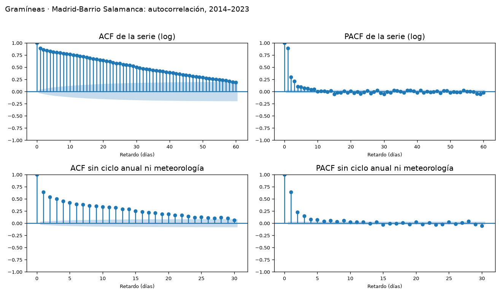
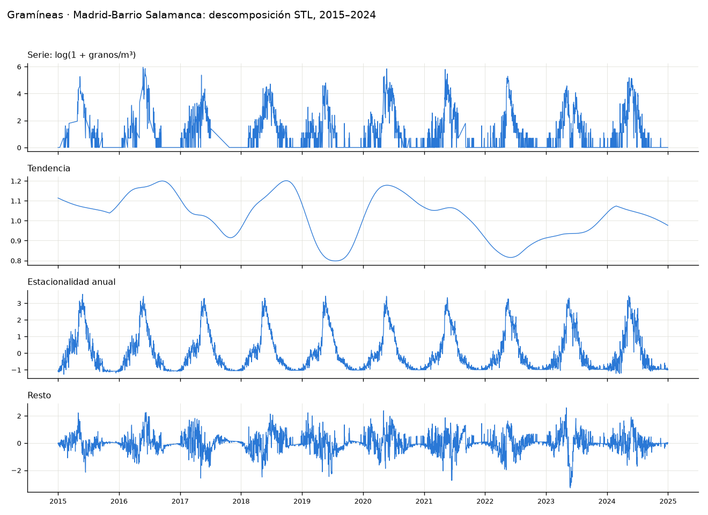
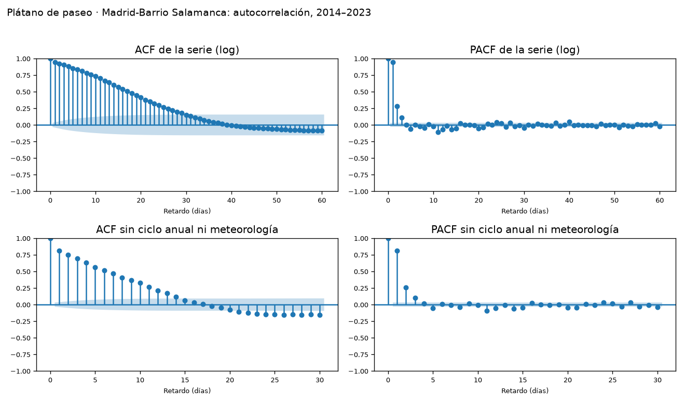
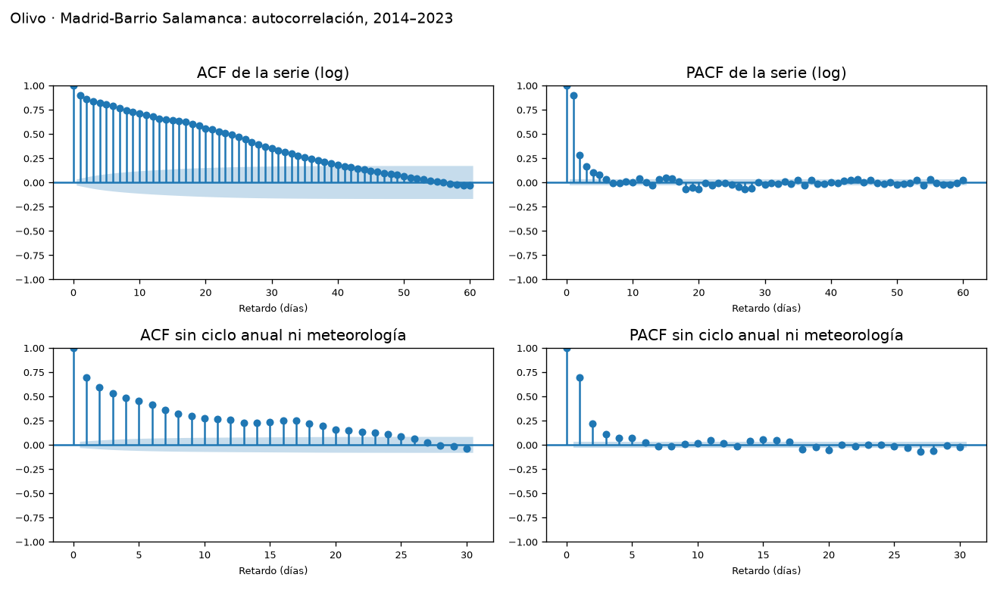
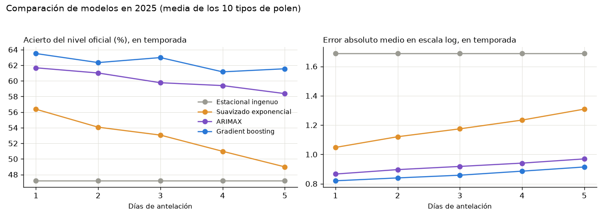
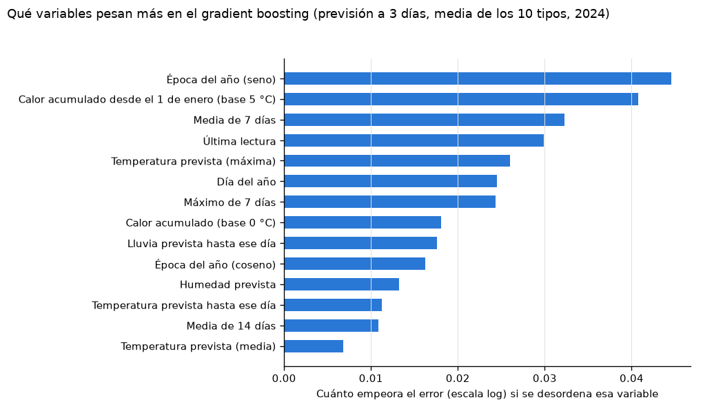
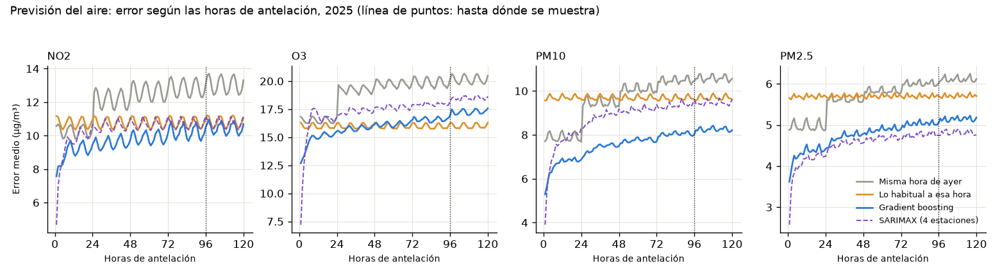

# Informe de modelos: cómo predecimos el polen y la calidad del aire

*Respira MAD · DataMad 2026. Hecho por `compare_models.py` y `train_air_model.py` (números y gráficos) el 16 de noviembre de 2026.*

Este informe compara cuatro formas de predecir el polen de los próximos cinco
días y explica cuál usa la aplicación para cada tipo de polen y por qué. La
previsión de la calidad del aire, también nuestra, está en la sección 8.

**Regla de datos.** Todos los datos de polen y de calidad del aire, medidos y
previstos, salen solo de la Comunidad de Madrid y del Ayuntamiento de Madrid
(sus estaciones y su histórico publicado). Las previsiones las hacen nuestros
propios modelos con esos datos. Lo único externo es la meteorología
(Open-Meteo) y la búsqueda de lugares.

## 1. Qué se predice y con qué reglas

- **La serie.** Para cada estación de la Red Palinocam y cada tipo de polen
  hay una serie diaria de granos por metro cúbico desde 1993. Todos los modelos
  trabajan con `log(1 + granos/m³)`: el logaritmo "aplasta" los picos enormes y
  el `1 +` permite que haya días con cero.
- **El retraso.** Las lecturas se publican unos 3 días tarde. Una previsión
  hecha el día D solo conoce lecturas hasta D−3. Por eso "mañana" (día +1) está
  en realidad a 4 días de la última lectura, y el día +5 a 8 días.
- **Entrenar, elegir, probar.** Los modelos se ajustan con datos **hasta
  2023**. Con **2024** se elige el modelo de cada tipo de polen, se decide qué
  previsiones son FIABLES y se calibran los intervalos. **2025** es la prueba:
  no se usa para decidir nada, así que sus números son una medida honesta de
  cómo funcionará con datos nuevos. Durante 2024 y 2025 no se reajusta nada:
  solo se les van dando las lecturas nuevas con su retraso.
- **Meteorología honesta.** Para los días que se predicen, los modelos que usan
  el tiempo reciben la *previsión* meteorológica tal como se emitió entonces
  (archivo de Open-Meteo), no el tiempo que hizo después.
- **Mismas condiciones para todos.** Los cuatro modelos se evalúan sobre
  exactamente las mismas 350.520 filas de 2024 y 2025 (estación, tipo, día, antelación), con
  las mismas métricas:
  - **MAE en escala logarítmica**: el error medio, en valor absoluto, entre
    `log(1 + previsto)` y `log(1 + real)`. Cuanto más bajo, mejor. Un MAE de
    0,7 significa equivocarse, de media, en un factor de 2 aproximadamente.
  - **Acierto del nivel oficial**: porcentaje de días en que la previsión cae
    en el mismo nivel oficial (bajo, medio, alto, muy alto) que la medición.
  - Solo se cuentan los **días de temporada** de cada tipo de polen. Fuera de
    temporada todo es "bajo" y cualquier método acierta casi el 100 %.

## 2. Por qué el polen es una serie difícil

1. **Ciclo anual muy marcado.** Cada tipo aparece unas semanas al año y el
   resto del tiempo está a cero. La fuerza estacional (STL) es alta, pero la
   temporada no empieza el mismo día cada año: depende del calor acumulado.
2. **Muchos ceros.** Entre el 46 % y el 78 % de los días de las series de
   ejemplo son cero. Los modelos clásicos suponen errores "en campana"
   (normales) y eso no se cumple cuando la serie se pega al cero.
3. **Picos.** En temporada la concentración puede multiplicarse por diez de un
   día a otro (viento, un día seco tras la lluvia) y volver a bajar.
4. **El tiempo manda.** La lluvia limpia el aire, el calor adelanta la
   floración, el viento trae polen de fuera.
5. **Retraso y huecos.** Se predice a ciegas 4–8 días después de la última
   lectura, y hay días (y a veces meses) sin lectura en algunas estaciones.

### Diagnóstico de tres series de ejemplo (Madrid-Barrio de Salamanca, 2014–2023)

| Serie | ADF (serie) | p | ADF (sin ciclo anual) | p | Días con cero | Fuerza estacional (STL) |
|---|---|---|---|---|---|---|
| Gramíneas · Madrid-Barrio Salamanca | -6.0 | 0.0000 | -8.4 | 0.0000 | 44% | 0.78 |
| Plátano de paseo · Madrid-Barrio Salamanca | -8.4 | 0.0000 | -11.0 | 0.0000 | 78% | 0.75 |
| Olivo · Madrid-Barrio Salamanca | -7.8 | 0.0000 | -10.1 | 0.0000 | 69% | 0.74 |

- **Prueba ADF (Dickey-Fuller aumentada).** Pregunta si la serie "deambula" sin
  volver a su nivel (raíz unitaria). Un valor p menor que 0,05 lo descarta. En
  las tres series p < 0,0001, con y sin el ciclo anual: **no hace falta
  diferenciar la serie (d = 0)**. La estacionalidad se trata aparte, con
  términos de Fourier.
- **ACF y PACF.** La ACF de la serie original baja muy despacio: es el ciclo
  anual. Al quitar el ciclo anual y la meteorología, la ACF decae poco a poco y
  la PACF tiene 2–3 retardos claros: es el patrón de un modelo AR de orden bajo
  con algo de media móvil, es decir, un ARMA(1–2, 1–2).
- **STL.** Separa la serie en tendencia (casi plana), estacionalidad anual (la
  "joroba" de cada primavera) y resto (los picos y valles que quedan, de tamaño
  parecido a la propia estacionalidad: ahí está la dificultad).

| Serie | ACF / PACF | Descomposición STL |
|---|---|---|
| Gramíneas |  |  |
| Plátano de paseo |  |  |
| Olivo |  |  |

## 3. Los cuatro modelos

### a) Estacional ingenuo (referencia)
"Habrá lo mismo que el mismo día del año pasado." No aprende nada: sirve de
listón mínimo. Si un modelo no lo supera, no merece la pena.

### b) Suavizado exponencial (ETS / Holt)
Mantiene un "nivel" que se actualiza con cada lectura nueva: una parte α de la
lectura y el resto del nivel anterior. Holt añade una tendencia, y Holt
amortiguado hace que esa tendencia se vaya apagando. Se probaron las tres
variantes en cada serie y se eligió la de menor AIC: en 99 de 100 series ganó
el **suavizado simple** (sin tendencia), con α ≈ 0,5. Su previsión es una línea
plana a partir del último nivel: no sabe nada del calendario ni del tiempo.

### c) ARIMAX (regresión armónica dinámica)
Es una regresión con errores ARMA:

`log(1 + granos) = ciclo anual + meteorología del día + error ARMA`

- **Ciclo anual**: pares de senos y cosenos (términos de Fourier) de periodo
  365,25 días. El número de pares (de 1 a 8) se elige con el AIC; salen 6–8
  porque la temporada es una joroba estrecha y hacen falta muchas ondas para
  dibujarla.
- **Variables exógenas**: temperatura media, lluvia (en logaritmo), viento
  máximo y humedad del propio día. Ejemplo (gramíneas, Barrio de Salamanca):
  cada grado más sube el polen un 6–7 %, y la lluvia lo baja.
- **Error ARMA(p, 0, q)**: lo que añaden las últimas lecturas. d = 0 por la
  prueba ADF; p y q se eligen por AIC entre siete candidatos sugeridos por la
  ACF/PACF. En casi todos los tipos gana ARMA(2, 0, 1).
- Se ajusta un modelo por estación y tipo con 2014–2023 (statsmodels,
  `SARIMAX`). Da intervalos de predicción de forma nativa.
- DECISIÓN NUESTRA: si el error típico de una previsión pasa de 3 en escala
  log (un intervalo que abarca un factor de miles), esa previsión se da por
  fallida y responde el gradient boosting. Pasa en 47 de 350.520 filas, casi
  todas de encinas y robles en Las Rozas, una estación con huecos.

### d) Gradient boosting (el modelo que ya tenía la aplicación)
Muchos árboles de decisión pequeños que se corrigen unos a otros
(scikit-learn). Un modelo por tipo de polen y día de antelación, entrenado con
**todas las estaciones juntas y con toda la historia (1993–2023)**. Usa 27
variables: día del año, últimas lecturas y su antigüedad, medias de 7 y 14
días, tendencia, media de la red, mismo día del año anterior, calor acumulado
desde el 1 de enero, lluvia de 7/14/30/90 días y la previsión del tiempo.
- Usa regresión cuantílica: un modelo predice la media y otros tres predicen
  a qué distancia de ella quedan los percentiles 10, 50 y 90. La mediana es la
  previsión central y el tramo 10–90 es el intervalo del 80 %.
- **Una sola fuente de verdad.** El nivel que muestra la aplicación es siempre
  la **mediana leída contra los umbrales oficiales**, igual en el planificador,
  el gráfico y el asistente. Antes el nivel salía de un clasificador aparte y
  podía diferir en un nivel de la línea del gráfico. Comprobación (2025,
  temporada, media de 10 tipos): la mediana acierta el nivel exacto el 61,3 %
  de los días y el clasificador el 61,7 %; en los tres niveles de la
  aplicación, 68,1 % frente a 69,3 %. La diferencia es de un punto, así que se
  usa la mediana. El clasificador solo se conserva para esta comparación.

## 4. Resultados

En cada celda: **acierto del nivel oficial / MAE en escala log**, días de
temporada, media de las antelaciones +1 a +5. En negrita, el modelo elegido.

### 2024: el año en que se elige

| Tipo de polen | Estacional ingenuo: acierto / MAE | Suavizado exponencial: acierto / MAE | ARIMAX: acierto / MAE | Gradient boosting: acierto / MAE | Elegido |
|---|---|---|---|---|---|
| Plátano de paseo | 49% / 1.48 | 36% / 2.05 | 48% / 1.36 | **53% / 1.05** | Gradient boosting |
| Cipreses y arizónicas | 43% / 1.84 | 50% / 1.41 | 47% / 1.20 | **59% / 0.96** | Gradient boosting |
| Encinas y robles | 41% / 1.55 | 37% / 1.03 | **55% / 0.73** | 50% / 0.77 | ARIMAX |
| Olivo | 47% / 1.68 | 57% / 1.17 | **65% / 0.82** | 61% / 0.82 | ARIMAX |
| Gramíneas | 39% / 1.64 | 45% / 0.94 | 56% / 0.70 | **56% / 0.69** | Gradient boosting |
| Pinos | 62% / 1.70 | 58% / 1.09 | 65% / 0.86 | **66% / 0.90** | Gradient boosting |
| Chopos | 69% / 1.45 | 74% / 1.26 | 75% / 1.13 | **80% / 0.86** | Gradient boosting |
| Olmos | 36% / 2.15 | 55% / 1.31 | 58% / 1.09 | **66% / 0.80** | Gradient boosting |
| Llantenes | 26% / 1.80 | 50% / 0.72 | **48% / 0.61** | 38% / 0.77 | ARIMAX |
| Ortigas y parietarias | 54% / 1.15 | 68% / 0.93 | 76% / 0.70 | **75% / 0.65** | Gradient boosting |
| **Media** | 47% / 1.64 | 53% / 1.19 | 59% / 0.92 | 60% / 0.83 | 62% con el elegido |

**Regla de elección (decidida con 2024).** Para cada tipo de polen, entre
**ARIMAX y gradient boosting**, el de mayor acierto del nivel oficial; si
quedan a un punto o menos, el de menor MAE. El estacional ingenuo y el
suavizado exponencial son **referencias**: se miden y se publican, pero la
aplicación no puede usarlos (no usan la previsión del tiempo ni dan
intervalos útiles). En **llantenes** el suavizado exponencial fue el mejor en
2024 (50 % frente al 48 % de ARIMAX); por esa regla se usa ARIMAX.

### 2025: la prueba, sin tocar

| Tipo de polen | Estacional ingenuo: acierto / MAE | Suavizado exponencial: acierto / MAE | ARIMAX: acierto / MAE | Gradient boosting: acierto / MAE | Elegido |
|---|---|---|---|---|---|
| Plátano de paseo | 46% / 2.49 | 56% / 1.51 | 65% / 1.23 | **65% / 0.92** | Gradient boosting |
| Cipreses y arizónicas | 48% / 1.69 | 57% / 1.39 | 64% / 1.09 | **67% / 1.03** | Gradient boosting |
| Encinas y robles | 44% / 1.54 | 50% / 1.00 | **57% / 0.82** | 54% / 0.90 | ARIMAX |
| Olivo | 43% / 2.00 | 45% / 1.43 | **53% / 1.13** | 65% / 0.80 | ARIMAX |
| Gramíneas | 43% / 1.37 | 47% / 0.93 | 51% / 0.74 | **53% / 0.71** | Gradient boosting |
| Pinos | 54% / 1.45 | 53% / 0.99 | 65% / 0.74 | **65% / 0.79** | Gradient boosting |
| Chopos | 59% / 2.01 | 61% / 1.35 | 61% / 1.18 | **68% / 1.15** | Gradient boosting |
| Olmos | 47% / 1.54 | 48% / 1.46 | 61% / 0.93 | **61% / 0.88** | Gradient boosting |
| Llantenes | 39% / 1.30 | 51% / 0.75 | **54% / 0.62** | 55% / 0.56 | ARIMAX |
| Ortigas y parietarias | 51% / 1.47 | 56% / 0.94 | 62% / 0.85 | **60% / 0.87** | Gradient boosting |
| **Media** | 47% / 1.69 | 52% / 1.18 | 59% / 0.93 | 61% / 0.86 | 60% con el elegido |



Qué se ve:

- **El orden general se mantiene.** Estacional ingenuo 47 %, suavizado 52 %,
  ARIMAX 59 %, gradient boosting 61 %, igual que en 2024.
- **Elegir con otro año cuesta algo.** Con los modelos elegidos en 2024 el
  acierto medio de 2025 es del **60 %**; con gradient boosting en todos los
  tipos habría sido del 61 %. El caso más claro es el **olivo**: ARIMAX ganó en
  2024 (65 % frente a 61 %) pero en 2025 el gradient boosting fue muy superior
  (65 % frente a 53 %). No cambiamos la elección después de ver la prueba.
- En **encinas y robles** ARIMAX gana los dos años.
- Ningún modelo pasa del 70 % en el nivel exacto de cuatro categorías. En los
  tres niveles que usa la aplicación (bajo / medio / alto o más), los modelos
  elegidos aciertan el **66 %** de los días de temporada de 2025, frente al
  59 % de "la última lectura ajustada por la época del año".

### Tabla completa de 2025 por tipo de polen y día de antelación

| Tipo de polen | Día | Estacional ingenuo: acierto / MAE | Suavizado exponencial: acierto / MAE | ARIMAX: acierto / MAE | Gradient boosting: acierto / MAE | Días de temporada |
|---|---|---|---|---|---|---|
| Plátano de paseo | +1 | 46% / 2.49 | 60% / 1.23 | 65% / 1.08 | **66% / 0.79** | 390 |
| Plátano de paseo | +2 | 46% / 2.49 | 57% / 1.37 | 64% / 1.17 | **69% / 0.84** | 390 |
| Plátano de paseo | +3 | 46% / 2.49 | 57% / 1.50 | 65% / 1.25 | **67% / 0.92** | 390 |
| Plátano de paseo | +4 | 46% / 2.49 | 55% / 1.64 | **64% / 1.30** | 64% / 0.97 | 390 |
| Plátano de paseo | +5 | 46% / 2.49 | 52% / 1.79 | **65% / 1.36** | 62% / 1.05 | 390 |
| Cipreses y arizónicas | +1 | 48% / 1.69 | 59% / 1.35 | 65% / 1.09 | **67% / 1.03** | 680 |
| Cipreses y arizónicas | +2 | 48% / 1.69 | 58% / 1.38 | 65% / 1.10 | **68% / 1.02** | 680 |
| Cipreses y arizónicas | +3 | 48% / 1.69 | 58% / 1.37 | 63% / 1.09 | **66% / 1.02** | 680 |
| Cipreses y arizónicas | +4 | 48% / 1.69 | 56% / 1.39 | 64% / 1.09 | **68% / 1.04** | 680 |
| Cipreses y arizónicas | +5 | 48% / 1.69 | 55% / 1.46 | 63% / 1.11 | **65% / 1.06** | 680 |
| Encinas y robles | +1 | 44% / 1.54 | 55% / 0.88 | **59% / 0.76** | 55% / 0.82 | 710 |
| Encinas y robles | +2 | 44% / 1.54 | 51% / 0.96 | **58% / 0.80** | 54% / 0.89 | 710 |
| Encinas y robles | +3 | 44% / 1.54 | 50% / 0.99 | **58% / 0.82** | 53% / 0.92 | 710 |
| Encinas y robles | +4 | 44% / 1.54 | 47% / 1.05 | **57% / 0.84** | 53% / 0.91 | 710 |
| Encinas y robles | +5 | 44% / 1.54 | 45% / 1.12 | **55% / 0.87** | 55% / 0.95 | 710 |
| Olivo | +1 | 43% / 2.00 | 47% / 1.37 | 53% / 1.13 | **64% / 0.83** | 513 |
| Olivo | +2 | 43% / 2.00 | 45% / 1.43 | 53% / 1.12 | **65% / 0.82** | 513 |
| Olivo | +3 | 43% / 2.00 | 44% / 1.42 | 54% / 1.11 | **65% / 0.77** | 513 |
| Olivo | +4 | 43% / 2.00 | 44% / 1.43 | 52% / 1.12 | **69% / 0.77** | 513 |
| Olivo | +5 | 43% / 2.00 | 42% / 1.50 | 50% / 1.17 | **63% / 0.82** | 513 |
| Gramíneas | +1 | 43% / 1.37 | 54% / 0.80 | 53% / 0.70 | **55% / 0.67** | 729 |
| Gramíneas | +2 | 43% / 1.37 | 49% / 0.88 | 53% / 0.72 | **53% / 0.67** | 729 |
| Gramíneas | +3 | 43% / 1.37 | 47% / 0.94 | 50% / 0.74 | **52% / 0.69** | 729 |
| Gramíneas | +4 | 43% / 1.37 | 44% / 0.99 | 49% / 0.76 | **52% / 0.72** | 729 |
| Gramíneas | +5 | 43% / 1.37 | 42% / 1.05 | 50% / 0.78 | **51% / 0.77** | 729 |
| Pinos | +1 | 54% / 1.45 | 56% / 0.92 | **65% / 0.72** | 65% / 0.77 | 484 |
| Pinos | +2 | 54% / 1.45 | 54% / 0.97 | 64% / 0.74 | **65% / 0.80** | 484 |
| Pinos | +3 | 54% / 1.45 | 54% / 1.00 | 64% / 0.74 | **66% / 0.78** | 484 |
| Pinos | +4 | 54% / 1.45 | 51% / 1.02 | **64% / 0.74** | 64% / 0.79 | 484 |
| Pinos | +5 | 54% / 1.45 | 50% / 1.05 | **65% / 0.75** | 65% / 0.82 | 484 |
| Chopos | +1 | 59% / 2.01 | 63% / 1.24 | 66% / 1.08 | **68% / 1.05** | 417 |
| Chopos | +2 | 59% / 2.01 | 62% / 1.30 | 63% / 1.15 | **68% / 1.12** | 417 |
| Chopos | +3 | 59% / 2.01 | 62% / 1.35 | 61% / 1.19 | **68% / 1.14** | 417 |
| Chopos | +4 | 59% / 2.01 | 62% / 1.41 | 59% / 1.23 | **67% / 1.19** | 417 |
| Chopos | +5 | 59% / 2.01 | 59% / 1.47 | 58% / 1.25 | **68% / 1.24** | 417 |
| Olmos | +1 | 47% / 1.54 | 55% / 1.12 | 65% / 0.82 | **66% / 0.82** | 360 |
| Olmos | +2 | 47% / 1.54 | 53% / 1.28 | **64% / 0.87** | 62% / 0.84 | 360 |
| Olmos | +3 | 47% / 1.54 | 49% / 1.47 | 61% / 0.94 | **62% / 0.89** | 360 |
| Olmos | +4 | 47% / 1.54 | 44% / 1.64 | 59% / 0.98 | **61% / 0.89** | 360 |
| Olmos | +5 | 47% / 1.54 | 42% / 1.80 | **57% / 1.03** | 56% / 0.98 | 360 |
| Llantenes | +1 | 39% / 1.30 | 53% / 0.66 | **58% / 0.57** | 57% / 0.54 | 611 |
| Llantenes | +2 | 39% / 1.30 | 51% / 0.71 | 56% / 0.60 | **57% / 0.54** | 611 |
| Llantenes | +3 | 39% / 1.30 | 51% / 0.74 | 54% / 0.62 | **56% / 0.54** | 611 |
| Llantenes | +4 | 39% / 1.30 | 50% / 0.78 | 52% / 0.64 | **54% / 0.57** | 611 |
| Llantenes | +5 | 39% / 1.30 | 48% / 0.83 | **52% / 0.66** | 51% / 0.60 | 611 |
| Ortigas y parietarias | +1 | 51% / 1.47 | 59% / 0.89 | **63% / 0.80** | 60% / 0.85 | 652 |
| Ortigas y parietarias | +2 | 51% / 1.47 | 56% / 0.91 | **62% / 0.89** | 61% / 0.86 | 652 |
| Ortigas y parietarias | +3 | 51% / 1.47 | 57% / 0.93 | **62% / 0.81** | 60% / 0.86 | 652 |
| Ortigas y parietarias | +4 | 51% / 1.47 | 54% / 0.96 | **61% / 0.91** | 59% / 0.89 | 652 |
| Ortigas y parietarias | +5 | 51% / 1.47 | 52% / 0.99 | **62% / 0.86** | 60% / 0.89 | 652 |

### Qué variables pesan más

Importancia por permutación del gradient boosting (cuánto empeora el error si
se desordena una variable), previsión a 3 días, media de los 10 tipos, 2024:



Lo que más pesa es **la época del año y el calor acumulado desde el 1 de
enero** (que adelanta o retrasa la temporada), después **las últimas
lecturas** (media de 7 días, última lectura, máximo de 7 días) y después **la
previsión del tiempo** (temperatura máxima, lluvia, humedad).

### Intervalos de predicción del 80 %: calibrados con 2024

"Cobertura" es el porcentaje de días de temporada en que el valor real cayó
dentro del intervalo del 80 %. Lo ideal es un 80 %. Los intervalos de los dos
modelos se quedaban cortos, así que se calibran con **conformal partido**
(*split conformal*, en su versión para cuantiles): con los días de temporada
de 2024 se mide cuánto hay que ensanchar el intervalo por cada lado (en escala
log) para que cubra el 80 %, por tipo, modelo y día de antelación. Ese margen
se aplica tal cual a 2025 y en la aplicación.

| Tipo de polen | Modelo usado | Antes | Después | Anchura media (log): antes → después | Fourier (pares) | Orden ARMA |
|---|---|---|---|---|---|---|
| Plátano de paseo | Gradient boosting | 77% | 89% | 2.43 → 3.18 | 8 | (3, 0, 0) |
| Cipreses y arizónicas | Gradient boosting | 74% | 77% | 2.94 → 3.14 | 8 | (2, 0, 1) |
| Encinas y robles | ARIMAX | 63% | 76% | 1.94 → 2.49 | 6 | (2, 0, 1) |
| Olivo | ARIMAX | 43% | 66% | 1.57 → 2.68 | 8 | (2, 0, 1) |
| Gramíneas | Gradient boosting | 71% | 80% | 1.95 → 2.26 | 8 | (2, 0, 1) |
| Pinos | Gradient boosting | 78% | 86% | 2.47 → 3.00 | 8 | (2, 0, 1) |
| Chopos | Gradient boosting | 60% | 69% | 2.37 → 2.88 | 8 | (2, 0, 1) |
| Olmos | Gradient boosting | 66% | 78% | 2.07 → 2.54 | 8 | (1, 0, 2) |
| Llantenes | ARIMAX | 60% | 79% | 1.33 → 1.88 | 8 | (2, 0, 1) |
| Ortigas y parietarias | Gradient boosting | 63% | 68% | 1.94 → 2.13 | 7 | (2, 0, 1) |
| **Media (modelo usado)** | | 66% | 77% | | | |
| Media gradient boosting (10 tipos) | | 72% | 80% | | | |
| Media ARIMAX (10 tipos) | | 54% | 79% | | | |

- Con los modelos que usa la aplicación, la cobertura media pasa del **66 % al
  77 %**. Gradient boosting: del 72 % al 80 %. ARIMAX: del 54 % al 79 %.
- Queda corta en **olivo** (66 %), **chopos** (69 %) y **ortigas** (68 %): en
  2025 fallaron más que en 2024. En plátano de paseo y pinos el intervalo
  queda algo ancho (86–89 %).
- Los intervalos son más anchos que antes: ese es el precio de que sean
  honestos.


## 5. Qué modelo usa la aplicación y por qué

| Tipo de polen | Modelo en la aplicación (elegido con 2024) |
|---|---|
| Gramíneas, plátano de paseo, cipreses y arizónicas, pinos, chopos, olmos, ortigas y parietarias | **Gradient boosting** |
| Encinas y robles, olivo, llantenes | **ARIMAX** |

Además, la previsión de cada tipo y día solo se muestra si ese modelo superó
la prueba **FIABLE en 2024**: acertar el nivel de la aplicación al menos 5
puntos más que "la última lectura ajustada por la época del año", con menor
error medio y al menos 200 días-estación de temporada. Lo superan **36 de las
50** combinaciones de tipo y día de antelación (+1 a +5):

| Tipo de polen | +1 | +2 | +3 | +4 | +5 |
|---|---|---|---|---|---|
| Plátano de paseo, cipreses y arizónicas, encinas y robles, pinos, chopos | sí | sí | sí | sí | sí |
| Gramíneas | sí | sí | sí | sí | no |
| Olivo | sí | sí | no | sí | sí |
| Ortigas y parietarias | no | sí | no | no | sí |
| Olmos | no | no | no | no | sí |
| Llantenes | no | no | no | no | no |

Donde no es FIABLE, la aplicación dice **"Sin previsión fiable"**: no se usa
ninguna previsión de fuera (regla de datos). El gráfico muestra la mediana y
el intervalo calibrado del modelo elegido, con marcadores huecos donde no es
FIABLE.

### Los días sin lectura: estimación del modelo (*nowcast*)

El polen se publica con 3 a 7 días de retraso, así que entre la última lectura
de una estación y hoy hay días sin dato. La aplicación los rellena con la
estimación del propio modelo **para ese mismo día**, hecha con lo que se sabía
ese día (antelación 0, la misma configuración que se probó, con su acierto de
2025). Así siempre hay un valor para hoy. En el gráfico, la línea continua es
lo medido y la discontinua lo estimado o previsto. Cuantos más días sin
lectura, menos segura es la estimación: si pasan más de 7 días desde la última
lectura, la etiqueta de confianza del día baja un nivel (decisión nuestra).
Se usa la estación de polen más cercana que tenga una lectura de los últimos
10 días; las que no la tienen se saltan y se nombran.

## 6. Límites que conviene tener presentes

- **Un año para elegir, un año para probar.** Son pocos: la diferencia entre
  ARIMAX y gradient boosting es de pocos puntos en varios tipos y cambia de un
  año a otro (olivo).
- **Los intervalos calibrados aún se quedan algo cortos** en algunos tipos
  (olivo, chopos, ortigas) porque 2025 se pareció poco a 2024.
- **Los picos se suavizan.** Todos los modelos predicen bien la "semana alta"
  pero no el día exacto del máximo. El 24 de mayo de 2025 el modelo dio
  gramíneas "alto" para el 28 en Madrid-Arganzuela (111 granos/m³ de mediana);
  ese día fue "muy alto" (392 de media en la red).
- Los modelos estadísticos se ajustaron con 2014–2023 y miran las lecturas de
  los últimos 120 días; el gradient boosting usa 1993–2023.
- La previsión del tiempo de 2024 se aproxima con la de las zonas del modelo
  del aire (véase `pollen_model/issued_weather.py`); la de 2025 es la emitida
  para cada estación.

## 7. Cómo repetirlo

```
.venv/bin/pip install statsmodels matplotlib
.venv/bin/python train_pollen_model.py     # descarga datos y entrena el clasificador
.venv/bin/python compare_models.py         # diagnósticos, modelos, comparación y gráficos (unos 10 minutos)
```

Resultados en `pollen_model/`: `comparison.csv` (todas las métricas, 2024 y
2025), `interval_coverage.csv` (cobertura antes y después de calibrar),
`model_choice.json` (modelo elegido por tipo), `arimax_params.json` (ARIMAX
ajustados), `quantile_models.joblib` (intervalos del gradient boosting) y
`plots/`.

## 8. Previsión de la calidad del aire (NO2, O3, PM10, PM2,5)

*Hecho por `train_air_model.py` el 16 de noviembre de 2026. Tablas completas en
`air_model/comparison_tables.md`.*

### Qué se predice y con qué datos

- **Hora a hora, hasta 5 días (120 horas)**, para cada estación que mide el
  contaminante: 52 estaciones de la Comunidad de Madrid y del Ayuntamiento de
  Madrid (NO2 en 48, O3 en 38, PM10 en 32, PM2,5 en 21).
- **Datos:** el histórico horario oficial de las dos redes desde 2019. La
  previsión se hace desde la última lectura de cada estación.
- **Meteorología:** la única entrada no oficial. Las estaciones se agrupan en 8
  zonas y cada zona usa una serie de Open-Meteo. Para probar en 2024 y 2025 se
  usa la previsión meteorológica *tal como se emitió* 1 a 5 días antes, no el
  tiempo que hizo. SIMPLIFICACIÓN: ese archivo es muy lento, así que se
  descargó para las 3 zonas con más estaciones (41 de 52); las demás usan su
  propio tiempo desplazado por el error de previsión de la zona más cercana.
- **Separación, la misma para todos:** se entrena hasta 2023, se **elige** con
  2024 y se **prueba** con 2025, que no se usa para decidir nada.

### Los modelos

1. **Referencia: "la misma hora de ayer".** Lo último medido a esa misma hora.
2. **"Lo habitual a esa hora"**: la media de la estación por mes, día laborable
   o festivo y hora (aprendida hasta 2023). Sirve de segunda referencia.
3. **SARIMAX** con estación de 24 horas y la meteorología como variables
   exógenas, sobre `log(1 + valor)`. Un modelo por estación y contaminante,
   orden elegido por AIC entre tres candidatos, ajustado con 2023 y aplicado
   mirando los últimos 14 días. Es lento, así que se probó en 4 estaciones
   (Escuelas Aguirre, Casa de Campo, Alcalá de Henares, Getafe).
4. **Gradient boosting** con variables retardadas: un modelo por contaminante
   para todas las estaciones. Entradas: horas de antelación, hora, día de la
   semana y época del año, la estación, sus últimas lecturas (última, 1 y 2
   horas antes, medias de 6 y 24 horas, máximo de 24 horas, misma hora de
   ayer), lo habitual a esa hora y la previsión meteorológica para la hora
   prevista (temperatura, viento, lluvia, humedad, radiación).

### Resultados

Error medio (µg/m³), media de cada día de antelación. Mismas filas para los
tres modelos (las 4 estaciones de SARIMAX):

| Contaminante | 2024 (elección): SARIMAX / gradient boosting | 2025 (prueba): SARIMAX / gradient boosting |
|---|---|---|
| NO2 | 11,0 / **10,3** | **10,4** / 11,1 |
| O3 | 17,7 / **15,6** | **17,4** / 17,7 |
| PM10 | 10,0 / **8,8** | 8,8 / **8,2** |
| PM2,5 | 4,7 / **4,6** | **4,6** / 4,9 |

Con 2024 gana el gradient boosting en los cuatro contaminantes, así que es el
modelo de la aplicación. **En 2025 SARIMAX fue algo mejor en NO2, O3 y PM2,5**
en esas 4 estaciones (por menos de 1 µg/m³). No cambiamos la elección después
de ver la prueba: hacerlo sería elegir con el año de prueba. El gradient
boosting tiene además una ventaja práctica: un solo modelo sirve para todas
las estaciones y es rápido.

En todas las estaciones, el gradient boosting frente a "la misma hora de
ayer" en 2025 (error medio y acierto de la categoría oficial del ICA):

| Contaminante | Día +1 | Día +2 | Día +3 | Día +4 | Día +5 |
|---|---|---|---|---|---|
| NO2 | 9,0 vs 10,3 (87 % vs 86 %) | 9,6 vs 12,2 | 9,9 vs 12,6 | 10,2 vs 12,9 | 10,4 vs 13,0 (85 % vs 83 %) |
| O3 | 14,8 vs 16,5 (72 % vs 69 %) | 15,8 vs 19,3 | 16,2 vs 19,8 | 16,6 vs 19,9 | 17,3 vs 20,2 (68 % vs 62 %) |
| PM10 | 6,6 vs 7,9 (76 % vs 74 %) | 7,4 vs 9,5 | 7,7 vs 10,1 | 8,0 vs 10,5 | 8,2 vs 10,6 (71 % vs 65 %) |
| PM2,5 | 4,3 vs 5,0 (71 % vs 68 %) | 4,7 vs 5,6 | 4,9 vs 5,8 | 5,0 vs 6,0 | 5,1 vs 6,1 (65 % vs 62 %) |



### Hasta dónde se muestra (nuestra regla)

Día a día, con 2024, el modelo elegido debe tener un error medio al menos un
**10 % menor que "la misma hora de ayer"** y al menos un **5 % menor que "lo
habitual a esa hora"**. Se muestra hasta el último día en que pasan los cuatro
contaminantes. Resultado con 2024: NO2, PM10 y PM2,5 pasan los cinco días; el
O3 pasa hasta el día 4 (el día 5 solo mejora lo habitual en un 3 %).
**La previsión del aire se muestra hasta 4 días (96 horas).** Más allá, el
planificador usa solo el polen y la meteorología, y lo dice.

### Hora a hora, de 1 a 120 horas

Cuánto menor es el error medio del modelo que el de "la misma hora de ayer",
por contaminante y horas de antelación (tabla completa, las 120 horas y las
dos referencias, en `air_model/comparison_by_hour.md`, hecha por
`air_model/lead_report.py`):

| Contaminante | Año | 1 h | 3 h | 6 h | 12 h | 24 h | 36 h | 48 h | 72 h | 96 h | 120 h |
|---|---|---|---|---|---|---|---|---|---|---|---|
| NO2 | 2024 | 29 % | 22 % | 15 % | 12 % | 9 % | 24 % | 22 % | 26 % | 25 % | 23 % |
| NO2 | 2025 | 28 % | 22 % | 13 % | 12 % | 9 % | 23 % | 21 % | 21 % | 20 % | 20 % |
| O3 | 2024 | 27 % | 23 % | 17 % | 13 % | 9 % | 24 % | 21 % | 26 % | 26 % | 23 % |
| O3 | 2025 | 25 % | 19 % | 10 % | 9 % | 8 % | 19 % | 18 % | 17 % | 16 % | 14 % |
| PM10 | 2024 | 41 % | 34 % | 26 % | 24 % | 19 % | 31 % | 30 % | 32 % | 34 % | 34 % |
| PM10 | 2025 | 31 % | 26 % | 17 % | 15 % | 10 % | 22 % | 19 % | 23 % | 23 % | 22 % |
| PM2,5 | 2024 | 32 % | 24 % | 18 % | 16 % | 14 % | 23 % | 22 % | 25 % | 27 % | 27 % |
| PM2,5 | 2025 | 26 % | 20 % | 14 % | 12 % | 9 % | 16 % | 14 % | 15 % | 16 % | 15 % |

- En **todas** las horas de 1 a 120, en los cuatro contaminantes y en los dos
  años, el modelo tiene menos error que "la misma hora de ayer". La menor
  mejora es del 6 % (O3, 22 horas, 2025).
- El punto débil está **alrededor de las 24 horas**: ahí "la misma hora de
  ayer" es justo la última lectura, una referencia muy buena. Con nuestra
  regla del 10 % aplicada hora a hora, en 2025 no la pasarían algunas horas
  entre las 9 y las 24 de NO2 y O3. La regla se decidió por días completos y
  con 2024, y no se cambia después de ver la prueba.
- Frente a "lo habitual a esa hora", el O3 de 2025 queda peor a partir del día
  4–5 (hasta un 9 % peor a las 118 horas): es la razón de no pasar de 96 horas.

### Comprobación de fuga de información (meteorología)

Un modelo probado con el tiempo que **realmente hizo** parecería mejor de lo
que es, porque en la vida real solo se conoce la **previsión**. Por eso:

- En 2024 y 2025 la prueba usa la previsión meteorológica **tal como se emitió**
  1 a 5 días antes de cada hora (archivo de ejecuciones anteriores de
  Open-Meteo, `previous-runs-api`), tanto para el gradient boosting como para
  SARIMAX. Para una antelación de *h* horas se usa la previsión emitida
  ⌈*h*/24⌉ días antes de la hora prevista.
- **Límites que quedan:** (1) antes del 19 de enero de 2024 no hay archivo, y en
  esas tres semanas del año de elección se usa el tiempo que hizo (2025 no
  tiene este problema); (2) el archivo se descargó para las 3 zonas con más
  estaciones (41 de 52); las otras 11 estaciones usan su tiempo real más el
  error de previsión de la zona más cercana; (3) justo a las 24, 48 y 72 horas
  la previsión usada pudo publicarse unas horas después del momento de la
  previsión (un poco optimista); en las demás horas se usa una previsión más
  antigua de lo necesario (un poco pesimista).
- Por estos límites, el horizonte se eligió de forma **conservadora**: el
  último día en que pasan los cuatro contaminantes (96 h), aunque NO2, PM10 y
  PM2,5 pasan los cinco días.

### Límites

- **O3 a partir del día 3.** En 2025 el gradient boosting sigue mejorando
  claramente "la misma hora de ayer" (16–18 %), pero queda un poco peor que
  "lo habitual a esa hora" (16,2 frente a 16,0 el día 3; 16,6 frente a 16,0 el
  día 4). Con 2024 sí lo mejoraba, por eso la regla lo deja pasar.
- El acierto de la categoría oficial mejora poco al día +1 (2–3 puntos): las
  primeras horas ya las acierta bien la referencia. La ventaja crece con los
  días.
- SARIMAX solo se probó en 4 estaciones.
- La previsión parte de la última lectura de cada estación (normalmente 1–2
  horas de retraso); una estación sin lecturas en las últimas 6 horas no tiene
  previsión y se usa la siguiente más cercana.
- La categoría se calcula con el valor horario, sin las medias de 8 y 24 horas
  del índice oficial (véase `config.py`).

### Cómo repetirlo

```
.venv/bin/python train_air_model.py      # unos 60 minutos; las descargas se guardan en model_data/
```

Resultados en `air_model/`: `models.joblib`, `climatology.npz`, `meta.json`
(estaciones, zonas, horizonte), `comparison_*.csv`, `comparison_tables.md` y
`plots/`.
