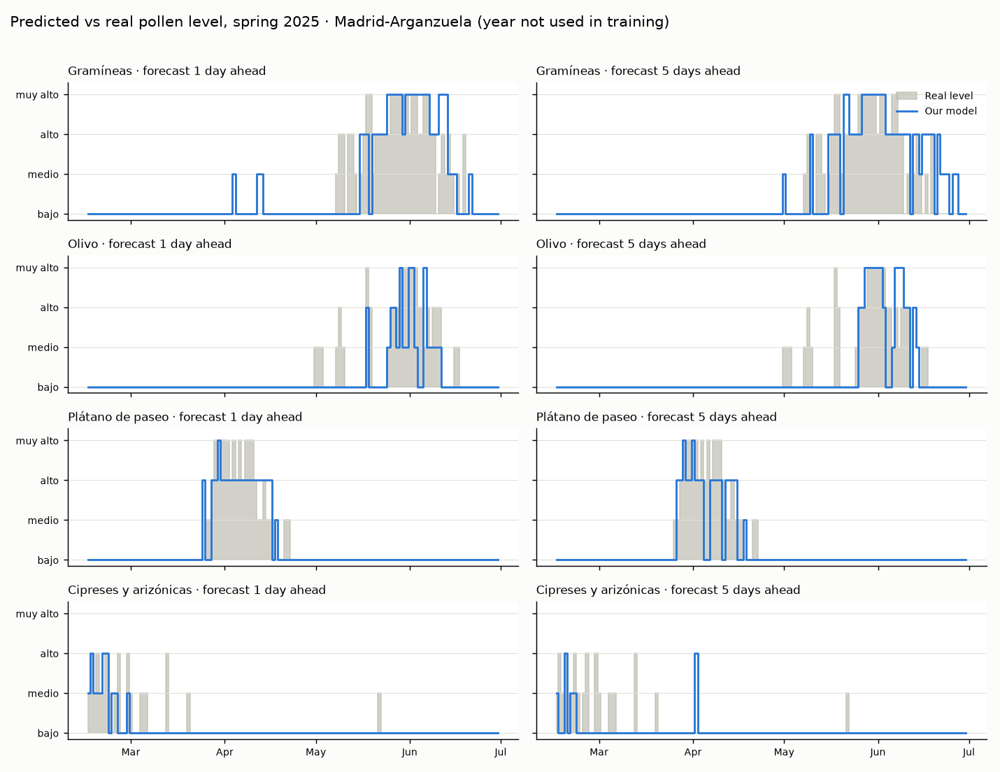

# Pollen forecast model: backtest report

Made on 2026-11-15 by `train_pollen_model.py`. Trained on 1993-05-01 to 2024-12-31, tested on 2025 (a year the model never saw).

## How to read this

- **Lead day**: how many days ahead (1 = tomorrow). Readings are published about 3 days late, so the forecast for lead day 5 is made about 8 days after the last reading it can see.
- **In season**: only the days of the year when that pollen type is normally around. Out of season everything is `bajo` and any method scores close to 100%, so those days are not counted.
- **Baseline**: the last available reading, adjusted for the usual seasonal change. The model has to beat this.
- **High days caught**: of the days that really were `alto` or `muy alto`, the share the forecast also put at `alto` or more.
- **Model right / Baseline right**: share of in-season days with the right level out of the three the app acts on (bajo, medio, alto-or-more; alto and muy alto give the same advice). **Exact level** is the stricter score out of all four official levels.
- **RELIABLE**: on in-season days, the model gets the app's level (bajo / medio / alto-or-more) right at least 5 percentage points more often than the baseline, with a smaller mean level error, and there are at least 200 in-season station-days in 2025 to judge from.
- The 2025 test used the weather forecasts as they were issued at the time (Open-Meteo previous-runs archive), not the weather that later happened. Training on earlier years used the weather that happened, because old forecasts are not archived.

## Result by pollen type and lead day (in season, 2025)

| Pollen type | Lead | Model right | Baseline right | Gain | Exact level (model / baseline) | High days caught (model / baseline) | In-season days | Verdict |
|---|---|---|---|---|---|---|---|---|
| Plátano de paseo | 0 | 82% | 72% | +10% | 69% / 62% | 85% / 65% | 390 | **RELIABLE** |
| Plátano de paseo | 1 | 80% | 71% | +9% | 66% / 62% | 90% / 62% | 390 | **RELIABLE** |
| Plátano de paseo | 2 | 77% | 69% | +8% | 69% / 61% | 82% / 58% | 390 | **RELIABLE** |
| Plátano de paseo | 3 | 78% | 69% | +10% | 68% / 61% | 77% / 55% | 390 | **RELIABLE** |
| Plátano de paseo | 4 | 72% | 65% | +7% | 64% / 59% | 54% / 47% | 390 | **RELIABLE** |
| Plátano de paseo | 5 | 72% | 64% | +8% | 61% / 59% | 68% / 44% | 390 | **RELIABLE** |
| Cipreses y arizónicas | 0 | 72% | 59% | +13% | 71% / 58% | 45% / 37% | 690 | **RELIABLE** |
| Cipreses y arizónicas | 1 | 70% | 59% | +11% | 69% / 58% | 37% / 36% | 690 | **RELIABLE** |
| Cipreses y arizónicas | 2 | 70% | 57% | +13% | 69% / 57% | 43% / 28% | 690 | **RELIABLE** |
| Cipreses y arizónicas | 3 | 71% | 59% | +13% | 70% / 57% | 40% / 27% | 690 | **RELIABLE** |
| Cipreses y arizónicas | 4 | 72% | 56% | +16% | 70% / 55% | 43% / 30% | 690 | **RELIABLE** |
| Cipreses y arizónicas | 5 | 69% | 55% | +14% | 67% / 54% | 30% / 27% | 690 | **RELIABLE** |
| Encinas y robles | 0 | 59% | 60% | -1% | 46% / 56% | 57% / 64% | 719 | not reliable |
| Encinas y robles | 1 | 61% | 59% | +2% | 57% / 56% | 52% / 62% | 719 | not reliable |
| Encinas y robles | 2 | 60% | 56% | +4% | 55% / 52% | 51% / 57% | 719 | not reliable |
| Encinas y robles | 3 | 60% | 55% | +5% | 55% / 52% | 56% / 54% | 719 | **RELIABLE** |
| Encinas y robles | 4 | 54% | 54% | -0% | 50% / 50% | 41% / 53% | 719 | not reliable |
| Encinas y robles | 5 | 59% | 51% | +9% | 55% / 47% | 44% / 50% | 719 | **RELIABLE** |
| Olivo | 0 | 78% | 57% | +20% | 65% / 49% | 78% / 65% | 513 | **RELIABLE** |
| Olivo | 1 | 65% | 55% | +10% | 59% / 46% | 38% / 61% | 513 | **RELIABLE** |
| Olivo | 2 | 71% | 52% | +19% | 58% / 42% | 74% / 52% | 513 | **RELIABLE** |
| Olivo | 3 | 71% | 55% | +16% | 59% / 44% | 74% / 51% | 513 | **RELIABLE** |
| Olivo | 4 | 77% | 56% | +22% | 65% / 44% | 81% / 52% | 513 | **RELIABLE** |
| Olivo | 5 | 72% | 58% | +14% | 65% / 47% | 71% / 53% | 513 | **RELIABLE** |
| Gramíneas | 0 | 73% | 67% | +6% | 58% / 57% | 81% / 73% | 729 | **RELIABLE** |
| Gramíneas | 1 | 73% | 68% | +4% | 59% / 57% | 78% / 76% | 729 | not reliable |
| Gramíneas | 2 | 76% | 65% | +11% | 59% / 51% | 83% / 74% | 729 | **RELIABLE** |
| Gramíneas | 3 | 76% | 63% | +13% | 60% / 49% | 87% / 72% | 729 | **RELIABLE** |
| Gramíneas | 4 | 72% | 61% | +12% | 59% / 50% | 85% / 71% | 729 | **RELIABLE** |
| Gramíneas | 5 | 71% | 60% | +11% | 57% / 48% | 82% / 70% | 729 | **RELIABLE** |
| Pinos | 0 | 68% | 59% | +8% | 62% / 55% | 51% / 39% | 474 | **RELIABLE** |
| Pinos | 1 | 68% | 57% | +11% | 63% / 54% | 48% / 33% | 474 | **RELIABLE** |
| Pinos | 2 | 65% | 55% | +10% | 58% / 52% | 55% / 30% | 474 | **RELIABLE** |
| Pinos | 3 | 72% | 55% | +17% | 62% / 52% | 69% / 33% | 474 | **RELIABLE** |
| Pinos | 4 | 64% | 54% | +10% | 58% / 49% | 45% / 36% | 474 | **RELIABLE** |
| Pinos | 5 | 68% | 55% | +13% | 63% / 50% | 46% / 40% | 474 | **RELIABLE** |
| Chopos | 0 | 71% | 68% | +3% | 69% / 64% | 27% / 48% | 409 | not reliable |
| Chopos | 1 | 71% | 66% | +5% | 70% / 63% | 12% / 37% | 409 | **RELIABLE** |
| Chopos | 2 | 71% | 63% | +8% | 70% / 60% | 11% / 29% | 409 | **RELIABLE** |
| Chopos | 3 | 69% | 60% | +9% | 68% / 58% | 6% / 22% | 409 | **RELIABLE** |
| Chopos | 4 | 68% | 58% | +10% | 68% / 56% | 6% / 16% | 409 | **RELIABLE** |
| Chopos | 5 | 69% | 57% | +12% | 69% / 55% | 10% / 13% | 409 | **RELIABLE** |
| Olmos | 0 | 80% | 76% | +4% | 70% / 66% | 74% / 75% | 360 | not reliable |
| Olmos | 1 | 82% | 72% | +9% | 69% / 59% | 79% / 73% | 360 | **RELIABLE** |
| Olmos | 2 | 77% | 69% | +8% | 64% / 60% | 76% / 67% | 360 | **RELIABLE** |
| Olmos | 3 | 74% | 66% | +9% | 63% / 54% | 54% / 62% | 360 | **RELIABLE** |
| Olmos | 4 | 72% | 61% | +11% | 62% / 52% | 54% / 57% | 360 | **RELIABLE** |
| Olmos | 5 | 75% | 58% | +17% | 63% / 49% | 63% / 51% | 360 | **RELIABLE** |
| Llantenes | 0 | 69% | 64% | +4% | 62% / 58% | 79% / 63% | 629 | not reliable |
| Llantenes | 1 | 66% | 63% | +3% | 57% / 57% | 81% / 58% | 629 | not reliable |
| Llantenes | 2 | 68% | 58% | +10% | 59% / 51% | 79% / 53% | 629 | **RELIABLE** |
| Llantenes | 3 | 69% | 59% | +9% | 59% / 53% | 85% / 51% | 629 | **RELIABLE** |
| Llantenes | 4 | 64% | 55% | +9% | 55% / 50% | 76% / 46% | 629 | **RELIABLE** |
| Llantenes | 5 | 60% | 54% | +6% | 53% / 49% | 62% / 44% | 629 | **RELIABLE** |
| Ortigas y parietarias | 0 | 69% | 64% | +5% | 64% / 59% | 37% / 55% | 642 | **RELIABLE** |
| Ortigas y parietarias | 1 | 70% | 61% | +9% | 65% / 56% | 45% / 53% | 642 | **RELIABLE** |
| Ortigas y parietarias | 2 | 69% | 58% | +12% | 63% / 52% | 39% / 51% | 642 | **RELIABLE** |
| Ortigas y parietarias | 3 | 71% | 57% | +15% | 64% / 49% | 46% / 52% | 642 | **RELIABLE** |
| Ortigas y parietarias | 4 | 70% | 58% | +12% | 59% / 52% | 50% / 52% | 642 | **RELIABLE** |
| Ortigas y parietarias | 5 | 68% | 53% | +15% | 62% / 48% | 47% / 49% | 642 | **RELIABLE** |

## If readings arrive later than 3 days

The same test with readings 6 days old (it happens): average in-season accuracy 68% for the model and 55% for the baseline, against 70% and 59% with 3-day-old readings.

## The 24 May 2025 check (grass)

Forecast made with only what was known on 24 May: readings up to 21 May and the weather forecast issued that day.

| Day | Lead | Stations predicted at each level | Real level at those stations | Real network average (grains/m³) |
|---|---|---|---|---|
| 25 May | 1 | 6 muy alto, 4 alto | 8 muy alto, 2 alto | 203 |
| 26 May | 2 | 9 muy alto, 1 alto | 10 muy alto | 302 |
| 27 May | 3 | 8 muy alto, 2 alto | 10 muy alto | 264 |
| 28 May | 4 | 6 muy alto, 4 alto | 10 muy alto | 392 |
| 29 May | 5 | 5 alto, 5 muy alto | 10 muy alto | 308 |

